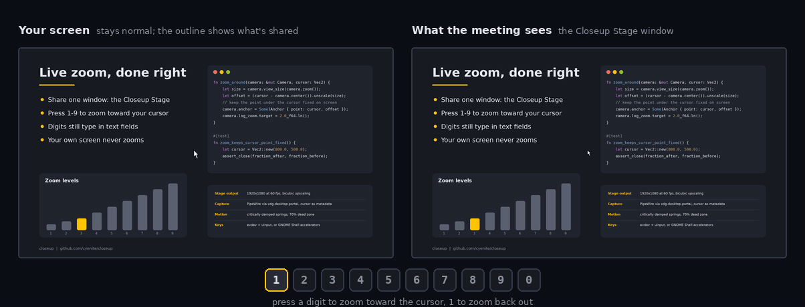
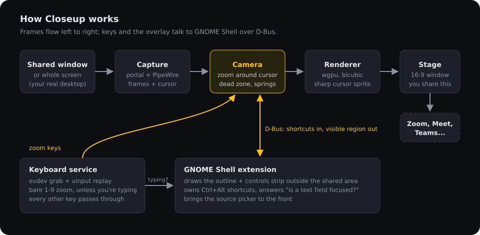
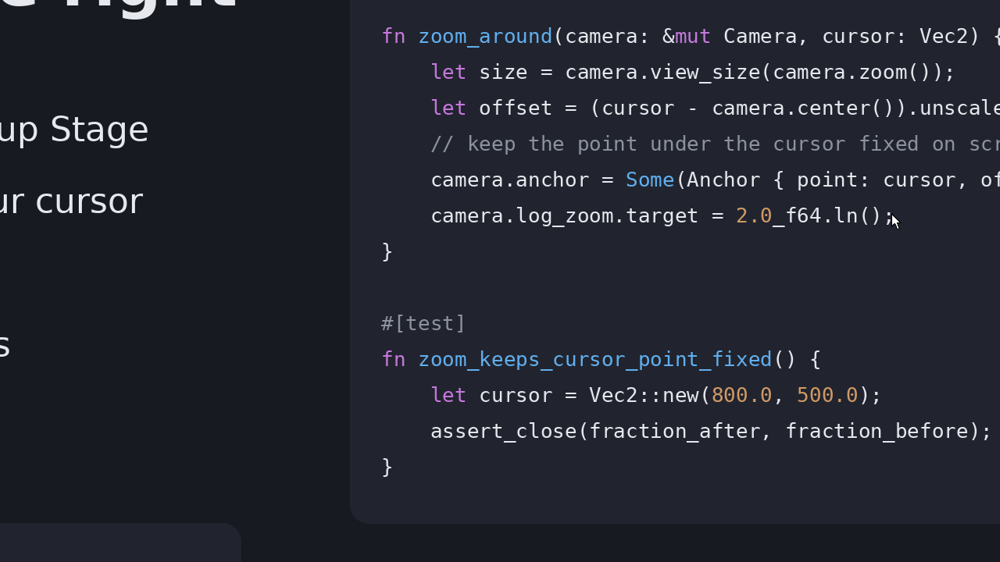
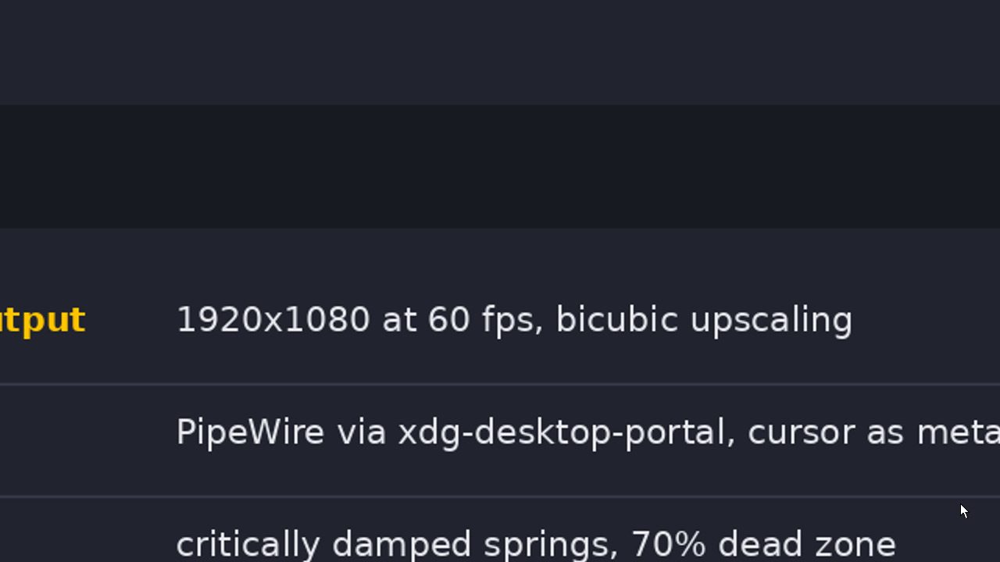

<div align="center">


# Closeup

**Live zoom for screen sharing on Linux.**
Share one window in your meeting, then press `1`-`9` to zoom the audience's view toward your cursor. Your own screen never zooms.

[](https://github.com/cyenite/closeup/actions/workflows/ci.yml)



<sub>Rendered by the app's own camera and GPU compositor (<code>scripts/demo/render.sh</code>) from a sample slide; the left pane redraws the outline the GNOME extension shows on your screen.</sub>

</div>

## Why Closeup

Screen magnifiers like ZoomIt zoom *your* screen, which is disorienting while you present. Post-production tools add zooms after the fact. Closeup zooms only what the audience sees, live:

- **Your screen stays put.** A yellow outline shows exactly what the meeting can see.
- **Digits just work.** `1`-`9` zoom when you're presenting and type normally when you're in a text field, with no mode to toggle.
- **Sharp when zoomed.** Capture is at native resolution, upscaling is bicubic, and the cursor is drawn at a constant size, so it never turns into a blurry arrow.
- **Calm motion.** The view only pans when the cursor nears the edge, using damped springs. Meeting encoders blur constant motion, so a calm camera stays crisp for viewers.
- **No share interruptions.** Switch what you're presenting with `Ctrl+Alt+S`; the meeting keeps sharing the same window throughout.

## Requirements

- GNOME Shell on Wayland: tested on GNOME 50, and the extension declares 46 to 50. The zoom also runs on other compositors, but the outline, typing detection and shell shortcuts need GNOME Shell.
- PipeWire and `xdg-desktop-portal` (standard on current distributions).
- A GPU with Vulkan.
- To build from source: Rust 1.88 or newer.

## Install

From a release archive (no Rust needed):

```bash
tar xzf closeup-v*-x86_64-linux.tar.gz && cd closeup-v*-x86_64-linux && setup/install.sh
```

From source:

```bash
git clone https://github.com/cyenite/closeup && cd closeup && setup/install.sh
```

`setup/install.sh` installs the build dependencies, then the app to `~/.local/bin`, a desktop entry, and the GNOME Shell extension. For bare-digit zoom it also needs you in the `input` group (see [Privacy and security](#privacy-and-security)); it **asks first**, and `--input-group` grants it without asking. Run it with `--user` to skip everything that needs `sudo`. Without the group, `Ctrl+Alt+1`-`9` and keys typed into the Stage window still zoom.

**Then log out and back in.** GNOME loads extension code and new group memberships only at login. If the installer says *reboot*, do that instead: with systemd lingering enabled, your user session outlives logouts and keeps its old groups.

Check everything with:

```bash
closeup --doctor
```

```text
[  ok] session          wayland on ubuntu:GNOME
[  ok] keyboards        2 readable; bare digits can zoom
[  ok] uinput           writable; other keys reach apps untouched
[  ok] shell extension  protocol 2
[  ok] screencast       portal v5, cursor metadata
[  ok] gpu              Intel(R) Graphics (RPL-U) (Vulkan)
[  ok] saved source     remembered; `closeup --pick` chooses again
```

## Use it

1. Start **Closeup** from the app grid (or run `closeup`). The source picker opens: choose the window or screen you want to present. Your choice is remembered for next time.
2. In Zoom, Meet, Teams or any other meeting app, share the window called **Closeup Stage**. It can sit behind other windows or on another workspace, but don't minimize it.
3. Present. Press digits to zoom; the view follows your cursor.

| Keys | Action |
|---|---|
| `1`-`9` | Zoom level: `1` is the whole source, then 1.5x, 2x, 3x, 4x, up to 8x |
| `0` | Lock or unlock panning (lock to move the cursor without moving the view) |
| `Ctrl+Alt+1`-`9`, `Ctrl+Alt+0` | The same, even while you're typing |
| `Ctrl+Alt+S` | Present something else, without stopping the share |
| `Ctrl+Alt+P` | Pause bare-digit zoom (rarely needed) |

**When do digits type instead of zoom?** When a text field has focus (GNOME's input method reports this for native and XWayland apps alike), or when you typed a letter in the last 1.2 seconds, which covers apps that never report text fields. Terminals always count as text fields; use `Ctrl+Alt+digit` there.

**The controls strip** next to the outline shows the zoom, the active level, whether digits zoom or type right now, and every shortcut. When you share a window it always shows, because window captures never include GNOME's own drawings. When you share a whole monitor it only appears in the area the audience can't see, so at 1x use the **Closeup** top-bar indicator instead: its menu lists the keys.

## Configure

Optional: copy [`config.example.toml`](config.example.toml) to `~/.config/closeup/config.toml`. Out-of-range values are clamped, with a warning in the log.

| Key | Default | Meaning |
|---|---|---|
| `levels` | `[1, 1.5, 2, 3, 4, 5, 6, 7, 8]` | Zoom for keys `1`-`9` (each at least 1.0, at most 9 entries) |
| `fps` | `60` | Stage frame rate (10 to 240) |
| `dead_zone` | `0.7` | Share of the view the cursor can roam before the view pans |
| `pan_omega` | `7.0` | Pan stiffness: higher follows faster |
| `zoom_omega` | `13.0` | Zoom stiffness: higher zooms faster |
| `cursor_scale` | `1.0` | Cursor size relative to 1x |

## How it works



1. **Capture.** The ScreenCast portal hands Closeup a PipeWire stream of the source you picked. The cursor arrives as metadata (position plus bitmap) rather than baked into the frames, and a window's crop region is applied on the way in.
2. **Camera** (`crates/closeup-core`, pure and unit-tested).
   - Pressing a level animates the zoom while keeping the point under your cursor fixed on screen.
   - The view then pans only when the cursor leaves the central 70%, and only by as much as needed.
   - Motion runs on critically damped springs, which never overshoot and behave the same at any frame rate. The cursor is never allowed within 4% of the visible edge, however fast it moves.
3. **Renderer.** A wgpu pipeline samples the captured frame through the camera's viewport with Catmull-Rom bicubic filtering. It then draws the cursor at a constant size and letterboxes odd-shaped sources into a 16:9 Stage.

   | 2x on code | 4x on small print |
   |---|---|
   |  |  |

4. **Keys.**
   - The keyboard service reads keyboards through evdev and grabs them. Everything except a zooming digit is replayed through a uinput virtual keyboard, so apps see your typing unchanged.
   - It switches the grab only when no keys are down, so nothing gets stuck.
   - The `Ctrl+Alt` shortcuts are registered with GNOME Shell itself, so they work with no keyboard access at all.
5. **Overlay.** The GNOME Shell extension receives the visible region as fractions of the source. It draws the outline and strip *outside* that region, so a whole-monitor share never shows them inside the zoomed output. It also answers "is a text field focused?" from the shell's input method, and brings the source picker to the front.

| Path | Owns |
|---|---|
| `crates/closeup-core` | Camera: levels, anchoring, dead zone, edge push, springs |
| `crates/closeup/src/capture` | Portal session with saved source, PipeWire stream, lost-source recovery |
| `crates/closeup/src/render` | `Renderer` (any texture) and `Compositor` (the Stage window) |
| `crates/closeup/src/input` | Keyboards, grab plus uinput replay, typing-aware `KeyRouter`, hot-plug |
| `crates/closeup/src/overlay.rs`, `shell.rs` | The D-Bus link to the extension, versioned by `PROTOCOL_VERSION` |
| `crates/closeup/src/doctor.rs` | `closeup --doctor` |
| `gnome-extension/` | Outline, controls strip, top-bar indicator, typing detection, shortcuts |

## Troubleshooting

| Symptom | Fix |
|---|---|
| Digits only work while the Stage window has focus | `closeup --doctor` names the cause. Usually the logout or reboot after setup is still pending. |
| No outline or strip | The extension isn't running the installed version: log out and back in, then check `gnome-extensions info closeup@closeup.app`. |
| The picker shows every start | Normal after the shared window was closed; pick again or run `closeup --pick`. |
| The meeting shows a frozen Stage | The Stage window is probably minimized; minimized windows may stop updating in window shares. Keep it open, behind other windows or on another workspace. |
| Endless mirror effect | You're sharing the monitor that shows the Stage window. Put the Stage on another monitor or workspace. |
| Digits type in a terminal | Expected: terminals count as text fields. Use `Ctrl+Alt+digit`. |

Run `closeup -v` for detailed logs, including Stage and source frame rates.

## Privacy and security

Closeup makes no network connections. It reads your screen only through the portal source you pick.

Bare-digit zoom needs the `input` group, and that group lets *any* program you run read raw keyboard input. The installer asks before adding you. If that's not acceptable on your machine, answer no (or use `--user`): the `Ctrl+Alt` shortcuts and the Stage-window keys keep working without it. `setup/uninstall.sh --system` removes the membership again.

While it runs, Closeup follows your login session. When the screen locks or another user's session takes over the seat, it releases the keyboards and acts on no keys until you're back. Lock-screen passwords and other users' typing then go straight to the system, not through Closeup's replay. Like anything in the `input` group, it still receives the raw events while you're away; it ignores them.

## Known limitations

- The outline and typing detection need GNOME Shell. The zoom itself works elsewhere.
- For window sources, the extension finds the shared window by its size and recent use, because the portal doesn't say which window was picked.
- On whole-monitor shares, the outline can flash at the edge of the audience's view for a frame during very fast pans.
- Not yet: recording to a file, DMA-BUF zero-copy capture, click highlights, a virtual camera output.

## Develop

```bash
cargo test --workspace                      # camera, key routing, config, shortcut parsing
cargo clippy --workspace --all-targets -- -D warnings
cargo run -p closeup -- -v                  # run from source with debug logs
scripts/demo/render.sh                      # regenerate docs/media from the real renderer
```

CI runs formatting, clippy, the tests, a syntax check of the extension, and shellcheck. Pushing a `v*` tag builds a release archive with the binary, the extension and the installer.

To remove Closeup: `setup/uninstall.sh` (add `--system` to also drop the uinput rule and leave the `input` group).
